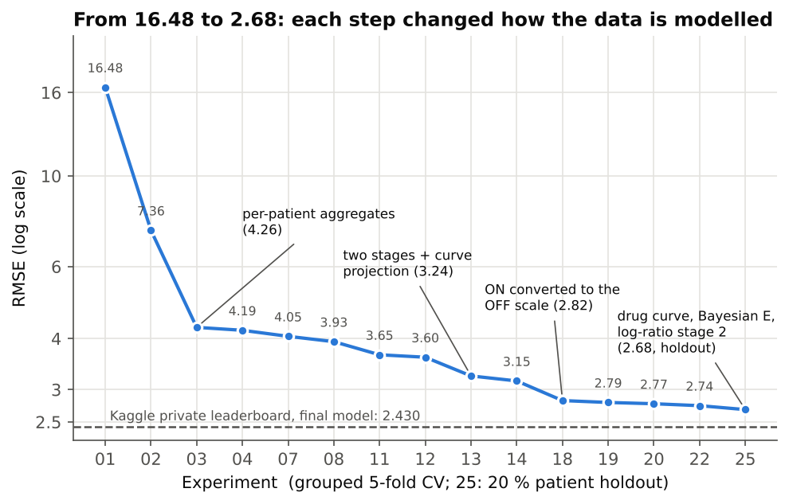

# Seeing through the noise: recovering the true Parkinson's motor score

[](https://www.python.org/)
[](https://scikit-learn.org/)
[](#results)

**17th of 294 teams (top 6 %) on the private leaderboard** of the Kaggle competition `bobathon-esilv`, with an RMSE of **2.43** against 16.48 for the reference (a constant prediction), and **up 7 places** from the public to the private leaderboard.

**[Full report (PDF)](report/rapport_SPS.pdf)** · **[5-minute video](https://youtu.be/-38HqgtiEek)**

[](https://youtu.be/-38HqgtiEek)

## The problem

Parkinson's disease is followed with the MDS-UPDRS motor score (part III). The score clinicians want, OFF (without medication), is hard to obtain: many visits only have an ON score, taken under medication, and every score is a noisy, biased rating. For every visit, we predict the true OFF score from these measurements, on test patients the model has never seen (44,590 training visits of 5,576 patients, 11,013 test visits of 1,395 patients), scored by RMSE.



*RMSE of every kept experiment (grouped 5-fold CV, log scale; 20 % patient holdout for the final model). The dashed line is the official private score. Details in section 6 of the [report](report/rapport_SPS.pdf).*

## What made the difference

Every large gain came from describing how the measurements are produced, not from tuning:

- **OFF is pulled down, not just noisy.** A measured OFF is the true score times a noise with a sharp peak at 1 and a long downward tail (median gap −4 points), so the high values are the most reliable. Visits are combined through a likelihood built on this real noise shape, not an average.
- **ON converted to the OFF scale, per patient.** ON = OFF × (1 − E × f(t)), with E the patient's sensitivity to the drug and f(t) the drug-effect curve since the last dose. Every ON-only visit (42 % of all visits) becomes an OFF-scale measurement: 0.33 RMSE gained at once.
- **A multiplicative bias per rater.** Each of the 50 raters multiplies ON and OFF by a personal factor (0.81 to 1.32), estimated and removed inside each training fold.
- **Smooth, never-decreasing trajectories.** A patient's true score follows a smooth curve in age that never decreases, so the predictions are projected onto a per-patient polynomial in age and made non-decreasing.

## Results

| | RMSE |
|---|---|
| Constant prediction (baseline) | 16.48 |
| First real model, HistGradientBoosting on the raw columns | 7.36 |
| Final model (exp 25), 20 % patient holdout | 2.678 |
| Kaggle public leaderboard (about 30 % of the test patients) | 2.799 |
| **Kaggle private leaderboard (official, about 70 %)** | **2.430, 17th of 294** |

## How to run

Python 3.12 or newer. Download the four competition CSV files from Kaggle into `data/` (the data is not redistributed here), then:

```bash
python -m venv .venv
source .venv/bin/activate        # Windows: .venv\Scripts\activate
pip install -r requirements.txt

python experiments/25_blend.py smoke    # quick check on 10 % of the patients
python experiments/25_blend.py submit   # full fit, writes submissions/25_blend.csv
python experiments/25_blend.py report   # 80/20 patient holdout + Skore report
python experiments/25_blend.py cv       # 5-fold grouped CV
```

- **Data:** `25_blend.py` reads `data/`, or `data_new/` if it exists, and needs the current version of the files, with the `rater_id` column; it stops with an error otherwise.
- **Skore Hub:** only the `report` step needs the key, read from a local `.skore` file (never committed) by `scripts/load_skore_credentials.py`.
- **Earlier experiments (01 to 22):** `python experiments/NN_name.py` runs the grouped CV, pushes the Skore reports (key needed) and, for most, writes a submission; from experiment 10 on, `SMOKE_TEST=1` runs a quick check on 10 % of the patients without the key.
- Experiments 01 to 21 used the first version of the files, so their scores cannot be reproduced exactly; from 12 on, each also reads the out-of-fold predictions of an earlier one from `audit/` (not included).

## Repository

| Path | Content |
|---|---|
| `experiments/` | One script per experiment, from `01_dummy.py` to `25_blend.py` (final model) |
| `report/` | The full report as a PDF (`rapport_SPS.pdf`: data, method, experiments, error analysis) and its figures |
| `data/` | Day 1 exploratory analysis (`eda.py`, `eda.md`); the competition CSV files go here |
| `scripts/` | `load_skore_credentials.py`, the Skore Hub sign-in helper |
| `requirements.txt` | Python packages, with the versions we used |

## Team

Team SPS, Bobathon ESILV × IBM × Probabl, October 2026:

- **Simon Prihnenko** ([simprih](https://github.com/simprih)): environment and first experiments (01 to 08), specification of variant A of the final model
- **Sacha Audouy** ([sacha54-jpg](https://github.com/sacha54-jpg)): high OFF statistics (10), leakage-free pipeline (11), variant B of the final model
- **Pierre Rancon** ([Pierre-gfp](https://github.com/Pierre-gfp)): experiments 12 to 22, the final model and the submissions

As the competition required, all the code of the model was written and run in IBM Bob: we wrote the specifications, Bob wrote the scripts, ran them and reported the scores, and every model was evaluated with skore and pushed to Skore Hub.

## License and credits

- The lab instructions, setup and skills come from the course repository [probabl-ai/bobathon-esilv](https://github.com/probabl-ai/bobathon-esilv) (Probabl × IBM × ESILV) and are not included here.
- The competition data belongs to the organisers of the Kaggle competition `bobathon-esilv` and is not redistributed here.
- `scripts/load_skore_credentials.py` is copied unchanged from [probabl-ai/skills-hackathon](https://github.com/probabl-ai/skills-hackathon), under the MIT License, Copyright (c) 2024-2026 Probabl:

<details>
<summary>MIT License of <code>scripts/load_skore_credentials.py</code></summary>

```text
MIT License

Copyright (c) 2024-2026 Probabl

Permission is hereby granted, free of charge, to any person obtaining a copy
of this software and associated documentation files (the "Software"), to deal
in the Software without restriction, including without limitation the rights
to use, copy, modify, merge, publish, distribute, sublicense, and/or sell
copies of the Software, and to permit persons to whom the Software is
furnished to do so, subject to the following conditions:

The above copyright notice and this permission notice shall be included in all
copies or substantial portions of the Software.

THE SOFTWARE IS PROVIDED "AS IS", WITHOUT WARRANTY OF ANY KIND, EXPRESS OR
IMPLIED, INCLUDING BUT NOT LIMITED TO THE WARRANTIES OF MERCHANTABILITY,
FITNESS FOR A PARTICULAR PURPOSE AND NONINFRINGEMENT. IN NO EVENT SHALL THE
AUTHORS OR COPYRIGHT HOLDERS BE LIABLE FOR ANY CLAIM, DAMAGES OR OTHER
LIABILITY, WHETHER IN AN ACTION OF CONTRACT, TORT OR OTHERWISE, ARISING FROM,
OUT OF OR IN CONNECTION WITH THE SOFTWARE OR THE USE OR OTHER DEALINGS IN THE
SOFTWARE.
```

</details>
