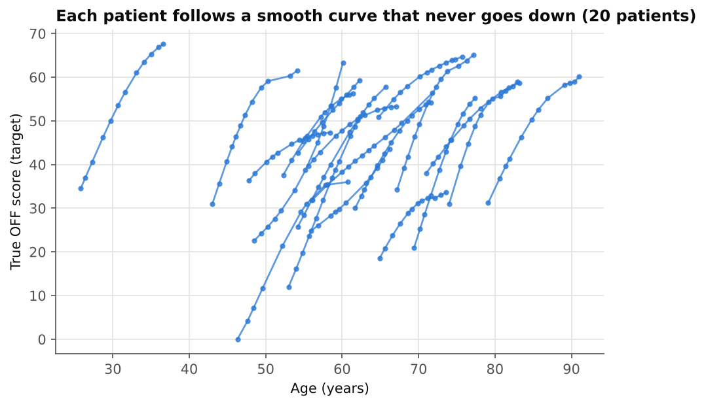
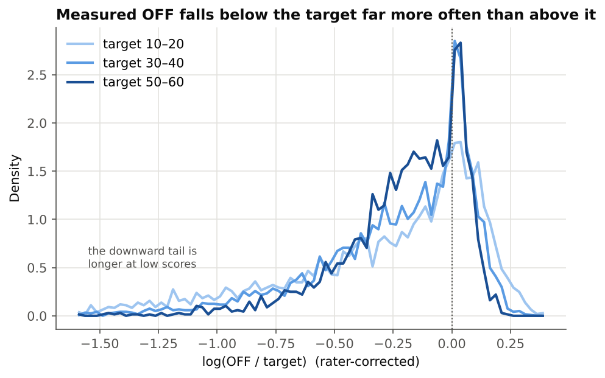
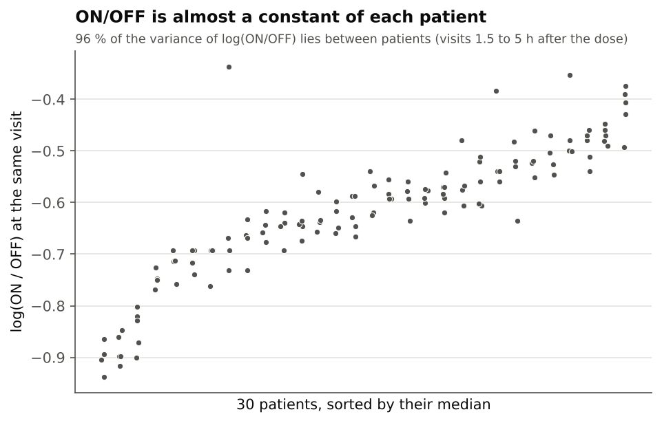
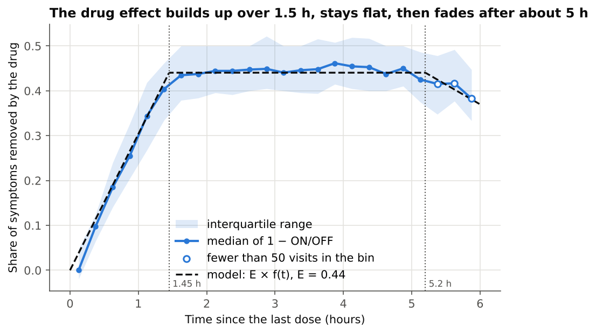
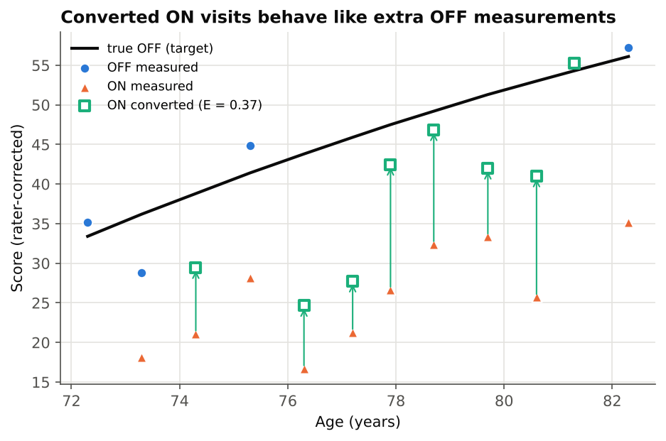
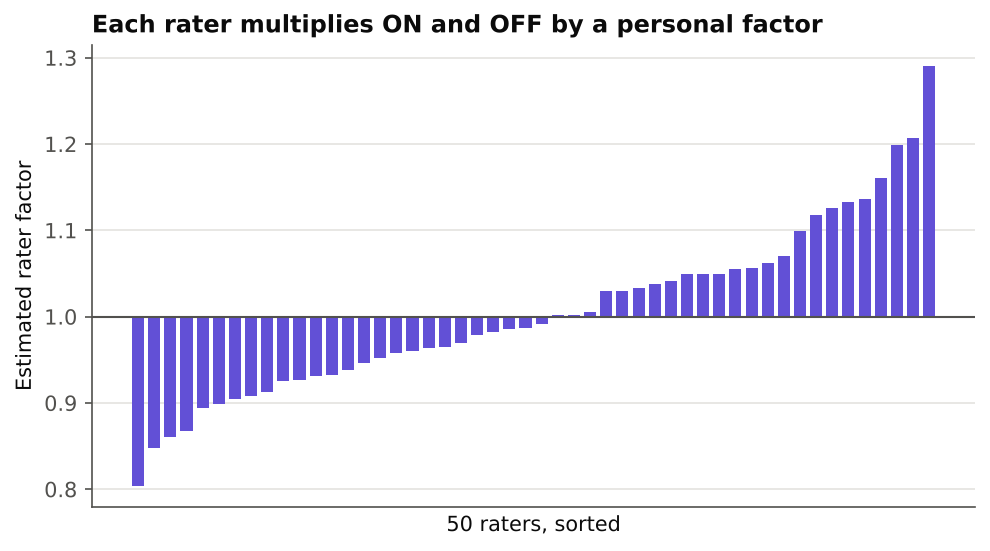
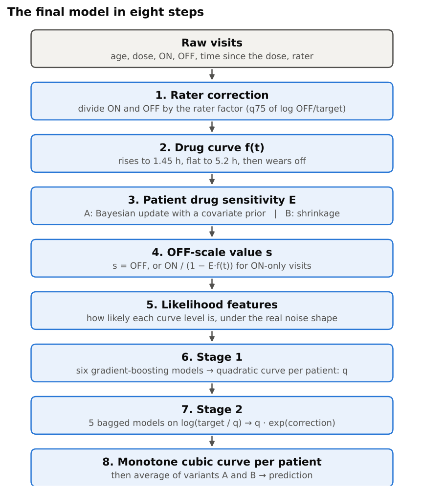
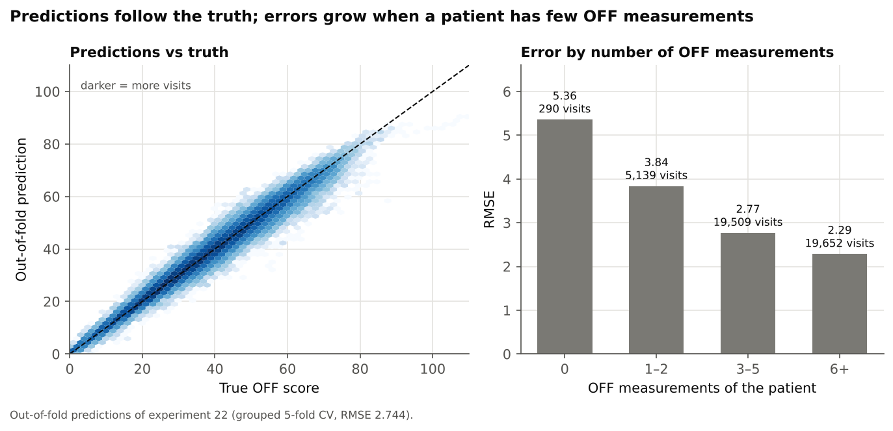
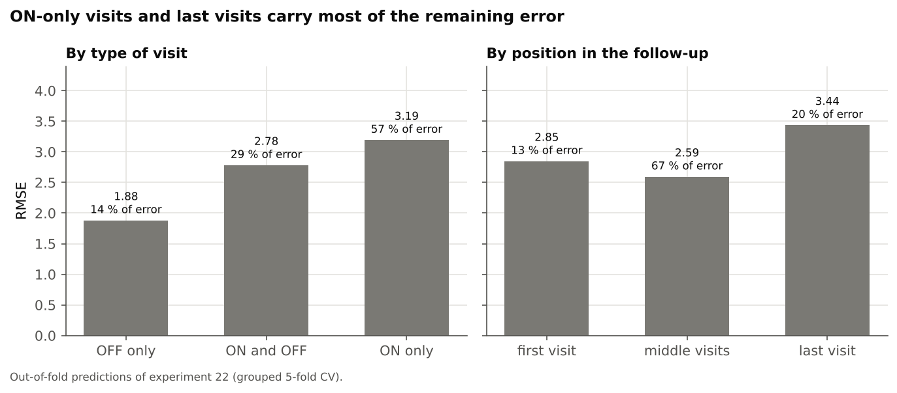

# Seeing through the noise: recovering the true Parkinson's motor score

[](https://www.python.org/)
[](https://scikit-learn.org/)
[](#72-public-and-private-leaderboards)

**17th on the private leaderboard** of the Kaggle competition `bobathon-esilv`, with an RMSE of **2.43** against 16.48 for the reference (a constant prediction), and **up 7 places** from the public to the private leaderboard.

[](https://youtu.be/-38HqgtiEek)

🎥 [5-minute video presentation](https://youtu.be/-38HqgtiEek)

**Team SPS:** Simon Prihnenko, Pierre Rancon, Sacha Audouy · Bobathon ESILV × IBM × Probabl, October 2026 · built on the course repository [probabl-ai/bobathon-esilv](https://github.com/probabl-ai/bobathon-esilv).

**Full report:** [report/rapport_SPS.pdf](report/rapport_SPS.pdf) (PDF, 21 pages).


*Grouped 5-fold CV of every kept experiment (log scale); the details are in [section 6](#6-how-we-got-there-the-experiment-journey).*

---

# Predicting the true OFF motor score in Parkinson's disease

**Bobathon ESILV (IBM Bob × Probabl), October 2026. Team SPS: Simon Prihnenko, Pierre Rancon, Sacha Audouy.**

**Team and roles.** We worked as a relay. Simon set up the environment and ran the first experiments (up to 08); Sacha found that the highest OFF values are the most reliable (10) and rebuilt the pipeline without leakage (11); Pierre ran experiments 12 to 22, then the final model, which combines Simon's specification (variant A) and Sacha's variant B, and made the submissions.

**Summary.** For every visit of a Parkinson's patient, we predict the true OFF motor score (MDS-UPDRS part III) from noisy ON and OFF measurements. We treated it as a measurement problem: each patient follows a smooth disease curve, and every score we see is a biased, noisy view of that curve. The final model removes the bias of each rater, converts ON scores to the OFF scale with a drug-effect model estimated per patient, combines all the measurements of a patient through a likelihood that uses the real shape of the noise, and corrects a first estimate with a second gradient-boosting stage before projecting each patient onto a non-decreasing curve. It scored 2.430 on the official leaderboard (17th of 294 teams), against 16.48 for a constant prediction.

| | RMSE |
|---|---|
| Constant prediction (mean of the target) | 16.48 |
| First real model, HistGradientBoosting on the raw columns | 7.36 |
| Previous version of the final model (exp 22), same 20 % patient holdout | 2.76 |
| Final model (exp 25), 20 % patient holdout | 2.678 |
| Kaggle public leaderboard (about 30 % of the test patients) | 2.799 |
| **Kaggle private leaderboard (official, about 70 %)** | **2.430, 17th of 294 teams** |

Final code: `experiments/25_blend.py`. Skore Hub report of the submitted model: https://skore.probabl.ai/sps/bobathon-esilv/estimators/85087 (on the team's private Skore Hub workspace, so the link requires access).

<!-- toc -->
**Contents.** [How to run](#how-to-run) · [1. Context and task](#1-context-and-task) · [2. The data](#2-the-data) · [3. How we evaluated models](#3-how-we-evaluated-models) · [4. What the data told us](#4-what-the-data-told-us) · [5. The final model, step by step](#5-the-final-model-step-by-step) · [6. How we got there](#6-how-we-got-there-the-experiment-journey) · [7. Results and error analysis](#7-results-and-error-analysis) · [8. What did not work](#8-what-did-not-work) · [9. Engineering: working with Bob and skore](#9-engineering-working-with-bob-and-skore) · [10. Limits, lessons and next steps](#10-limits-lessons-and-next-steps) · [11. Conclusion](#11-conclusion) · [Appendix A. Experiments](#appendix-a-experiments) · [Appendix B. Day 1 and Day 2 questions](#appendix-b-day-1-and-day-2-questions) · [Appendix C. Glossary](#appendix-c-glossary) · [License and credits](#license-and-credits)
<!-- /toc -->

---

## How to run

Python 3.12 or newer. From the root of the repository:

```bash
python -m venv .venv
source .venv/bin/activate        # Windows: .venv\Scripts\activate
pip install -r requirements.txt
```

**Data.** The competition data is not included in this repository: the Kaggle rules forbid redistributing it. Download the four CSV files of the competition (`X_train.csv`, `y_train.csv`, `X_test.csv`, `sample_submission.csv`) from the Kaggle Data tab into `data/`. The script needs the current version, with the `rater_id` column, and stops with an error otherwise. If a folder `data_new/` exists, it is read instead of `data/`: during the competition we kept the first version of the files in `data/` and the current one in `data_new/`.

**Skore Hub.** Only the `report` step needs it. It reads the `.skore` file at the root of the repository, created by the course setup (sign-in with `skore-cli`), which holds the Hub URL, the workspace and the API key and is never committed; `scripts/load_skore_credentials.py` loads it before `skore.login(mode="hub")`. The other steps run without an account.

**Commands.**

```bash
python experiments/25_blend.py smoke    # quick check on 10 % of the patients
python experiments/25_blend.py submit   # full fit, writes submissions/25_blend.csv
python experiments/25_blend.py report   # 80/20 patient holdout + Skore report
python experiments/25_blend.py cv       # 5-fold grouped CV
```

On Windows we ran each step as `.venv\Scripts\python.exe -X utf8 -u experiments/25_blend.py <step>` (UTF-8 output, no buffering). A fit on 80 % of the patients takes about 12 minutes on a laptop. Each step keeps its result, so a rerun is cheap; delete the file to start the step again:

- `submit` does nothing if `submissions/25_blend.csv` already exists;
- `report` reuses the fitted model saved in `audit/report_25_wrapper.pkl`;
- `cv` reloads the folds already saved in `audit/oof_25_folds/`.

**Earlier experiments (01 to 22).** Each of these scripts does everything in one run: `python experiments/NN_name.py` runs the grouped CV, pushes the Skore reports and, for most of them, writes a submission file. They need the Skore key from the start, except in smoke mode: from experiment 10 on, `SMOKE_TEST=1` (PowerShell: `$env:SMOKE_TEST="1"`) runs a quick check on 10 % of the patients with 2 folds and saves nothing. Experiments 01 to 21 read `data/` and were run on the first version of the files (before the update of 9 October, without `rater_id`), so their scores cannot be reproduced exactly from the current files. Experiment 22 reads the current files from `data_new/` (the path is written in the code) and, for a diagnostic, the first version from `data/`. From experiment 12 on, each script also reads the out-of-fold predictions of an earlier experiment from `audit/` (not in the archive), so they only run in their original order. The header of each script gives its results, its Skore report and the files it reads.

---

## 1. Context and task

### 1.1 The clinical problem

The severity of Parkinson's disease is followed with the MDS-UPDRS motor score (part III): a clinician scores a series of motor tasks, and the total goes from 0 to 132. The value depends on when it is measured.

- **OFF state:** the patient has not taken the medication (levodopa) for a long time. This score reflects the disease itself, and it is the one clinicians want to follow over the years.
- **ON state:** the patient is under the effect of the medication, which removes part of the symptoms. How much lower the score is depends on the patient and on the time since the last dose.

The OFF score is hard to obtain: patients must stop their treatment, many visits only have an ON score, and every score carries the subjectivity of the person who rates it. The task is to recover, for every visit, the **true OFF score** (`target`) that the measurements are noisy views of.

### 1.2 The competition

- Kaggle competition `bobathon-esilv`, scored by RMSE over all test visits. The test set contains **only new patients**: the model never sees any visit of a test patient during training.
- All code had to be written and run in IBM Bob, and every model evaluated with skore and pushed to Skore Hub, with the report URL in the description of the Kaggle submission. Submissions only counted on 14 October between 08:15 and 12:00.
- The public leaderboard used about 30 % of the test patients, the private (official) one the other 70 %.

From the start we chose to trust only a validation that reproduces this setting, and to look for gains in the structure of the data rather than in hyperparameter tuning. Sections 3 and 4 explain both choices, and section 7 shows that they held up on the private leaderboard.

---

## 2. The data

### 2.1 Size and columns

| | Visits | Patients | Visits per patient |
|---|---|---|---|
| Train | 44,590 | 5,576 | 4 to 12, median 7 |
| Test | 11,013 | 1,395 | same distribution |

| Column | Meaning | Missing |
|---|---|---|
| `patient_id` | Patient identifier (groups the visits) | 0 % |
| `cohort` | Cohort A or B | 0 % |
| `sexM` | Sex | 0 % |
| `gene` | Genetic marker (4 values) | 32.4 % |
| `age_at_diagnosis` | Age at diagnosis | about 5 % (always for all visits of a patient) |
| `age` | Age at the visit | 0 % |
| `ledd` | Levodopa-equivalent daily dose | 36.6 % |
| `off` | Measured OFF score | 42.4 % |
| `on` | Measured ON score | 29.6 % |
| `time_since_intake_on` | Hours between the last dose and the ON measurement | 46.4 % |
| `time_since_intake_off` | Hours between the last dose and the OFF measurement | 78.8 % |
| `rater_id` | Who rated the visit (50 raters, added on 9 October) | 0 % |
| `target` | True OFF score, train only | 0 % |

No visit misses both `on` and `off`. Visits with OFF only are mostly untreated patients (no `ledd`), whose target is lower (mean 21 against 44).

### 2.2 The target and its correlations

The target goes from 0 to 109.5, with a mean of 37.5 and a standard deviation of 16.5: a constant prediction scores 16.5, the floor every model has to beat.

Its linear correlations are `off` 0.87, `on` 0.67, `age` 0.31, `ledd` 0.30 and `age_at_diagnosis` 0.13; the intake times and `sexM` are close to 0. These numbers hide most of the structure. `off` is biased low (on the same visits it is 5.4 points below the target, RMSE 10.2), `on` is far lower (22.5 against a true OFF of 44.3 on its visits), and the intake time matters a lot, but through its interaction with `on`, not on its own. Section 4 describes the real relationships.

### 2.3 The data update of 9 October

On 9 October the organisers replaced the files. Every column stayed identical except `on` and `off`, and a column `rater_id` appeared. Comparing the two versions value by value, we found that the new `on` and `off` are the old ones **multiplied by a fixed factor per rater and rounded** (95 % of the values exactly, all within one point). The 50 factors go from 0.81 to 1.32; each rater uses the same factor for ON and OFF, independent of the target, and `y_train` did not change. This is the rater subjectivity that the task describes, and the final model corrects it (section 5.1).

---

## 3. How we evaluated models

### 3.1 Grouped cross-validation

Because every test patient is new, we always split by patient: `GroupKFold(5)` on `patient_id`, with the same five folds for every experiment so that two models can be compared fold by fold.

A split by visit is misleading here. On the same simple model, it gave 3.29 where a split by patient gave 3.99: when visits of a patient are on both sides, the model reads the answer from the patient's other visits. The more a model uses patient-level information, the larger the gap (Day 2: Ridge 10.57 against 10.60, HistGradientBoosting 7.62 against 7.75).

### 3.2 Decision rule

An experiment was kept only if its mean CV was lower than the current best model **and** it was better on at least 4 of the 5 folds. The fold-to-fold standard deviation was about 0.04 to 0.08, and changing only the random seed of the second stage moved the score by about ±0.006, so differences below 0.01 were ignored.

### 3.3 Leakage control

Several components learn from the target: bias corrections, rater factors, noise densities, the second stage. Each of them is fitted inside the training part of each fold, never on the whole training set. When a component produces a feature for another model trained on the same rows (stage 1 feeding stage 2), its predictions are cross-fitted with an inner `GroupKFold`, so stage 2 only sees predictions made on patients that stage 1 did not train on. In experiment 10, a transformation fitted outside the folds made the CV too optimistic (3.74); experiment 11 rebuilt the pipeline without leakage, and every later experiment followed that rule.

### 3.4 Skore reports and the public leaderboard

Each experiment pushed an `EstimatorReport` to Skore Hub, built on one holdout of 20 % of the patients (`GroupShuffleSplit`, `random_state=0`). Its score differs from the 5-fold CV by about ±0.05, so we used the CV to choose and the reports to document and to compare models on a fixed split.

The public leaderboard covered only about 420 patients, against 5,576 in our CV. We used it once, on the morning of 14 October, to check that the model behaved as expected on the new data, and picked the final submission from our validation. Our public scores were always a little worse than our validation, never better.

---

## 4. What the data told us

Most of our progress came from understanding how the measurements are produced. Four facts carried the final model.

### 4.1 Each patient follows a smooth, increasing curve

As a function of age, the target of a patient is almost exactly quadratic: the residual of a per-patient parabola is 0.33 points, against 1.61 for a straight line. For about 68 % of the patients it is exactly cubic, and the others are cubic with a monotone correction. The target never decreases from one visit to the next and is never negative; its mean slope is 2.5 points per year (standard deviation 1.4).

Consequence: predictions should not be made visit by visit, but projected onto a smooth curve in age per patient, which removes most of the visit-level noise.



*Figure 1. True OFF score against age for 20 training patients drawn at random among those with at least 8 visits. In the whole training set, no patient has a target that decreases from one visit to the next.*

### 4.2 OFF is the target times a noise with a long downward tail

At a given visit, OFF ≈ target × v, where v is a visit-level noise with a sharp peak at 1 (a clean measurement, within about ±8 %) and a long tail downwards, which we attribute to residual medication at the time of the OFF measurement. The median of OFF − target is −4 points. This noise is independent from one visit to the next (correlation 0.07), cannot be predicted from the patient or the covariates (R² 0.01), and is wider at low scores: after the rater correction, the 5 %–95 % range of log(OFF / target) is [−1.33, +0.19] for targets between 10 and 20 and [−0.70, +0.09] between 50 and 60.

Consequence: averaging the OFF values of a patient underestimates the target, and a Gaussian error model is wrong. The high values are more informative than the low ones, and the right way to combine visits is a likelihood that uses the real shape of this noise.



*Figure 2. Distribution of log(OFF / target) on the training visits with a measured OFF, after the rater correction, for three bands of the target. All three peak at 0; the tail on the left is longest for low scores.*

### 4.3 ON is OFF reduced by the drug, with a patient constant

At visits where both scores exist, the ratio ON / OFF is almost a constant of the patient: 91 % of the variance of log(ON / OFF) lies between patients (92 % in the test set), and 96 % when we keep only the visits measured 1.5 to 5 hours after the dose, once the drug has fully acted (Figure 3). We model it as

> ON = OFF × (1 − E × f(t))

where t is `time_since_intake_on`, f(t) is the drug-effect curve, and **E is the patient's sensitivity to the drug**: the share of symptoms the medication removes at full effect (population median about 0.44). E varies between patients with a standard deviation of 0.094 and, around the patient's value, from visit to visit with a standard deviation of 0.079. It cannot be predicted well from the covariates.

The shape of f(t) can be read from the median of 1 − ON/OFF by intake time (Figure 4): the effect rises linearly for about 1.45 hours, stays flat, and fades after about 5.2 hours. Only 318 training visits are measured after 5.2 hours, so this last part rests on few points, but they follow the slope of the model.



*Figure 3. log(ON / OFF) at the visits of 30 random patients with at least 4 visits measured 1.5 to 5 hours after the dose, sorted by their median. The spread inside a patient is small next to the differences between patients.*



*Figure 4. Median of 1 − ON/OFF by quarter hour since the dose (visits with both scores and OFF ≥ 8), its interquartile range, and the model E × f(t) with the median E. Hollow points are bins with fewer than 50 visits.*

Consequence: every ON-only visit (42 % of all visits) can be turned into an OFF-scale value s = ON / (1 − E × f(t)). Our first attempt converted ON with an additive offset per patient; it failed at low scores, and the multiplicative form gained 0.33 RMSE at once (experiment 18). Figure 5 shows the conversion on a typical patient. The converted values do not fall exactly on the true curve, since they carry the same downward noise as OFF, but they become usable OFF-scale measurements: a patient with three OFF scores and eight ON-only visits is now estimated from eleven points instead of three.



*Figure 5. One training patient (E = 0.37), chosen by rule: among the patients with at least 9 visits, 3 ON-only visits with a known intake time and 4 OFF scores, the one whose conversion error is the median. The ON score at age 81.3 was taken at the time of the dose (f = 0), so its converted value is the measurement itself.*

### 4.4 Raters apply a constant multiplicative bias

Each of the 50 raters multiplies ON and OFF by the same personal factor (standard deviation of the log 0.098). Every patient sees 1 to 3 raters, assigned at random to the visits, and every rater appears in train and test and in both cohorts. The factor is unrelated to the target (correlation −0.006). It leaves ON / OFF unchanged, so E and f(t) are not affected, but it shifts the level of a visit by about ±10 %, more than the clean OFF noise (±8 %): it has to be removed before estimating the patient level.



*Figure 6. Factor of each rater estimated on the training set with the rule of section 5.1. The estimates go from 0.80 to 1.29; the factors measured by comparing the two versions of the files go from 0.81 to 1.32.*

### 4.5 Missing values and identifiers

- `age_at_diagnosis` is missing for all visits of 286 training patients (67 in the test). Every feature based on the time since diagnosis was then empty, and these patients had an RMSE of 5.89 against 3.43 for the others. Imputing it as the first visit age minus the median gap of the cohort (0.8 year in A, 1.2 in B) brought them to 3.17.
- `ledd` is more often missing in cohort B (42.6 %) than in A (35.9 %), and a missing dose often means an untreated patient, so we kept missingness explicit instead of filling it blindly.
- `time_since_intake_off` is missing 79 % of the time and is only used as a raw feature.
- `patient_id`, `Index` and the row order carry no usable information about the target; they are only used to group visits.

---

## 5. The final model, step by step

The final model (`experiments/25_blend.py`) fits two variants of the same two-stage model, which differ only in how they estimate the drug sensitivity E, and averages them. Figure 7 shows the whole pipeline; the subsections below follow its steps.



*Figure 7. The final model, from the raw visits to the prediction. Steps 3 to 8 run twice, once with each estimate of E, and the two predictions are averaged.*

### 5.1 Rater correction

For each rater, on the training visits with a measured OFF and a target above 12, we take the **75th percentile of log(OFF / target)**, centre these values across raters, and use exp(value) as the rater's factor. `on` and `off` are divided by the factor of their rater (1 for an unknown rater).

Why the 75th percentile: because of the downward tail of the OFF noise (4.2), the mean or the median of log(OFF / target) mixes the rater bias with the amount of residual medication, while the upper quartile sits on the clean peak and measures the rater alone. Why a target above 12: at very low scores the ratio is unstable. The factors are fitted inside each training fold.

### 5.2 Drug-effect curve f(t)

f(t) = t / 1.45 up to 1.45 h, 1 between 1.45 h and 5.2 h, then 1 − 0.2 × (t − 5.2) floored at 0, and 0.864 when t is missing. The wear-off part is what distinguishes it from our earlier curve, min(t / 1.5, 1): measurements taken late after the dose show less drug effect, and ignoring it made E look smaller for those visits.

### 5.3 Drug sensitivity E of each patient

A visit is "paired" when it has ON and OFF, OFF ≥ 8 and a known intake time. Each paired visit gives a direct estimate e = (1 − ON / OFF) / f(t), with an uncertainty that comes from the rounding of the scores (larger when OFF or f is small).

- **Variant A (Bayesian):** a small gradient-boosting model predicts E from patient covariates (cohort, gene, sex, age at diagnosis, first and last age, number of visits, mean dose); its cross-validated error gives the prior uncertainty. The patient's E is the precision-weighted average of this prior and of the patient's paired estimates.
- **Variant B (shrinkage):** E = λ × (median of the patient's e) + (1 − λ) × E_population, with λ = 0.094² / (0.094² + 0.079² / n) and n the number of paired visits. A patient with one paired visit is pulled strongly towards the population; a patient with eight is trusted almost fully.

Neither variant uses the target, so E is estimated the same way on test patients. Alone, the two variants score about the same, but their errors differ enough for their average to beat both (section 6).

### 5.4 OFF-scale values

Every visit gets s = OFF when OFF is measured, otherwise s = ON / (1 − E × f(t)), with the denominator floored at 0.15. It also gets a type, because the noise of s differs between them: OFF measured; ON with a known time and a patient E from paired visits; ON with a known time and a population E; ON without time. Per patient we add summaries of s: maximum, mean, median, 75th percentile, and the mean of the two and three highest values, since the high values are the most reliable (4.2).

### 5.5 Likelihood features

On the training fold, we estimate the empirical density of log(s / target) for each visit type and each of 10 target bands, on a fine grid. For a patient we can then ask: if the true curve were the current estimate q shifted by some amount, how likely would all the observed s values be? Scanning the shift gives a likelihood profile, from which we extract 10 features (posterior mean and spread of the shift, maximum-likelihood shift, implied multiplier, share of non-OFF visits, E and its uncertainty, among others). This is how the noise facts of 4.2 reach the model: a Gaussian average would treat a low and a high OFF as equally informative, the likelihood does not.

### 5.6 Stage 1

Stage 1 is the pipeline built during the first days (experiments 08 to 19):
- **Features:** imputed age at diagnosis, per-patient interpolation of `ledd`, a cross-fitted correction of the OFF and ON biases pooled per patient, a Bayesian linear mixed model of each patient's trajectory (`MixedLine`), statistics of the high OFF values of the patient (`UpperStats`), and an OFF value implied from ON.
- **Six models**, all `HistGradientBoostingRegressor`: a base model on all features, a simple model on raw columns and patient aggregates, three "evidence" models that see one visit at a time (whole visit, OFF only, ON only), and a severity-evidence model built on the OFF-scale values s.
- **Prediction:** (0.8 × base + 0.2 × simple), then 0.7 of that + 0.3 × severity evidence, projected onto a quadratic curve in age per patient. This curve is q.

The six models are trained with an inner 5-fold `GroupKFold`, so the q given to stage 2 is always an out-of-fold prediction.

### 5.7 Stage 2

Stage 2 learns how far the truth is from q at each visit, from about 160 columns: q compared with the visit's OFF, ON and s, patient-level summaries of these gaps, the evidence-model predictions, the 10 likelihood features, the E columns and the numeric features of stage 1.

- **Target:** log(target / q), both floored at 0.5. A relative correction suits a multiplicative noise: being 3 points off matters more at 15 than at 60.
- **Weights:** max(q, 1), so that the loss in log space stays close to the RMSE we are judged on.
- **Models:** five `HistGradientBoostingRegressor` (500 iterations, learning rate 0.03, 63 leaves, at least 150 visits per leaf), each trained on a random 80 % of the patients, averaged.
- **Prediction:** q × exp(average correction).

### 5.8 Final projection and blend

The stage-2 predictions of each patient are fitted with a polynomial in age of degree up to 3 (lower when the patient has fewer than four visits), then made non-decreasing: in age order, a value lower than the previous one is replaced by 1.02 × the previous one, since the true target never decreases and a dip can only be noise. Values are clipped at 0, and variants A and B are averaged with equal weights.

### 5.9 Running it

| Step | Command | What it does |
|---|---|---|
| smoke | `experiments/25_blend.py smoke` | Quick check on a small sample |
| submit | `experiments/25_blend.py submit` | Fits on all training data, writes `submissions/25_blend.csv` |
| report | `experiments/25_blend.py report` | Fits on 80 % of the patients, evaluates on the other 20 %, pushes the Skore report |
| cv | `experiments/25_blend.py cv` | 5-fold grouped CV, fold by fold |

The two variants are fitted in parallel (`joblib`, two processes); a fit on 80 % of the training set takes about 12 minutes on a laptop. Installation, data and exact commands are in *How to run*.

---

## 6. How we got there: the experiment journey

Each experiment is one script in `experiments/`, one CV run, one Skore report and, from 11 onwards, one Kaggle submission key (full list in Appendix A). The progression falls into six phases (Figure 8).


*Figure 8. Grouped 5-fold CV of every kept experiment (log scale), and the 20 % patient holdout of the final model, on which experiment 22 scored 2.76. The dashed line is the official private score of the final model.*

**Phase 1. Baselines (01 to 02): 16.48 → 7.36.** A constant prediction gives the floor; gradient boosting on the raw columns divides the error by more than two, almost entirely through `off` and `on`.

**Phase 2. Use all the visits of a patient (03 to 04): 7.36 → 4.19.** A single measurement is very noisy, but each test patient comes with all of its visits. Per-patient means, maxima and trends of OFF and ON brought the error to 4.26, and a linear smoothing within each patient to 4.19: in absolute terms, the largest gain of the project.

**Phase 3. Model the trajectory and correct the measurements (05 to 11): 4.19 → 3.65.** Cross-fitted OFF/ON bias correction (05), a Bayesian mixed linear model of each trajectory (07: 4.05), tuned boosting settings (08: 3.93), and statistics of the high OFF values, since the noise pulls OFF down (10). Experiment 10 leaked (section 3.3); 11 rebuilt it cleanly and reached 3.6472.

**Phase 4. A two-stage model (12 to 14): 3.65 → 3.15.** An OFF value implied from ON (12: 3.5987; the additive form was fixed in 18). The error analysis then showed the patients without an age at diagnosis; imputing it, projecting each patient onto a quadratic curve and adding a second stage gave **3.2370** (13), better on all folds. Evidence models and a bagged stage 2 gave **3.1453** (14).

**Phase 5. The drug-effect structure (15 to 20): 3.15 → 2.77.** Three ideas failed on most folds (15 to 17, section 8). Studying the ON/OFF ratio led to section 4.3: converting ON to the OFF scale gave **2.8150** (18), the largest gain of the second half; patients with 1 or 2 OFF measurements went from 4.29 to 3.87. Likelihood features with the level-dependent noise gave **2.7895** (19), twice the gain of a version without the level dependence. Averaging 19 with a shrunk-E variant gave **2.7650** (20); averaging models that only differ by their seed gave nothing.

**Phase 6. New data and final structure (21 to 25): 2.77 → 2.68.** A larger stage 2 (63 leaves instead of 15) reached 2.7237 (21) on the files of before 9 October; with the rater correction on the current files, 2.7442 (22, public 2.815). Experiment 25 brought the wear-off curve, the Bayesian and shrunk estimates of E, the log-ratio target and the monotone cubic projection: holdout A 2.6956, B 2.7050, **average 2.6784**, against 2.76 for experiment 22 on the same holdout. Public leaderboard **2.799**, private **2.430**. This is the submission we selected.

---

## 7. Results and error analysis

### 7.1 Scores of the main models

| Model | Grouped CV (5 folds) | Holdout (20 %) | Public LB | Private LB |
|---|---|---|---|---|
| 13_twostage | 3.2370 ± 0.079 | 3.26 | | |
| 14_evidence | 3.1453 ± 0.078 | 3.17 | | |
| 18_onratio | 2.8150 ± 0.044 | 2.86 | | |
| 19_likelihood | 2.7895 ± 0.044 | 2.80 | | |
| 20_blend | 2.7650 ± 0.041 | 2.78 | | |
| 21_bigstage2 (old files) | 2.7237 ± 0.047 | 2.74 | 2.820 | |
| 22_rater | 2.7442 ± 0.043 | 2.76 | 2.815 | |
| **25_blend (final)** | not run | **2.678** | **2.799** | **2.430** |

The full CV of experiment 25 takes several hours and could not be run before the deadline; its holdout is the same split as the Skore reports of the other models, so that column compares them fairly. The `cv` step prints, next to each fold, reference values written in the specification of the experiment (`EXPECTED_A`, `EXPECTED_B`, `EXPECTED_V` in the code, mean 2.677 for the average) to check the implementation against; they are not a score measured by this script, so we do not report them as one. Every kept experiment from 12 onwards improved all five folds (scores per fold in Appendix A).

### 7.2 Public and private leaderboards

Our public score (2.799) was a little worse than our holdout (2.678), as for every previous model: the public board covers few patients and its error is noisy. On the private board, 70 % of the test patients, the same model scored 2.430 and we moved up 7 places, to 17th of 294 teams, 0.004 behind the 16th team, while some teams that had made many submissions to climb the public board lost up to 11 places. We read this as a confirmation that the grouped validation measured what the leaderboard measures.

### 7.3 Where the error remains

This analysis uses the out-of-fold predictions of experiment 22 (RMSE 2.744), the last model with full out-of-fold predictions on the current files. The final model shares its structure and improves it by 0.08 on the holdout.

| Group | Visits | RMSE | Share of the squared error |
|---|---|---|---|
| Patient with 0 OFF measurement | 290 | 5.36 | 2.5 % |
| 1 to 2 OFF measurements | 5,139 | 3.84 | 22.5 % |
| 3 to 5 OFF measurements | 19,509 | 2.77 | 44.5 % |
| 6 or more OFF measurements | 19,652 | 2.29 | 30.6 % |
| OFF-only visit | 13,220 | 1.88 | 13.9 % |
| ON and OFF visit | 12,457 | 2.78 | 28.7 % |
| ON-only visit | 18,913 | 3.19 | 57.4 % |
| First visit of the patient | 5,576 | 2.85 | 13.5 % |
| Middle visits | 33,438 | 2.59 | 66.9 % |
| Last visit of the patient | 5,576 | 3.44 | 19.6 % |



*Figure 9. Left: out-of-fold prediction against the true score (darker cells hold more visits); the mean error is +0.006, so the model is not biased overall. Right: RMSE by the number of OFF measurements of the patient.*



*Figure 10. RMSE by type of visit and by position of the visit in the follow-up, with each group's share of the squared error.*

- **The number of OFF measurements drives the error:** 2.29 for patients with six or more, 3.84 for those with one or two. ON-only visits carry 57 % of the squared error. Part of the gap with OFF-only visits is the level (those are mostly untreated patients with low scores); we think the rest comes from the uncertainty on E, which a converted ON score adds to the measurement noise.
- **Well-measured patients are close to the noise floor.** On experiment 19, for patients with 6 OFF measurements or more, an oracle that knows the exact shape of the true curve and only estimates its level scored 2.37, and our model 2.33. Splitting each patient's error into level, slope, curvature and visit noise gave 58 %, 27 %, 14 % and 1 %: what remains is mostly the level of the curve.
- **The error is concentrated.** The worst 10 % of patients carry 51.6 % of the squared error, and 59 % of them are under-predicted: patients whose measurements happened to fall in the low tail of the noise, which no model can tell apart from a lower true score.
- **The last visit is harder** (3.44 against 2.63 for the others): the curve is extrapolated there, and fast-progressing patients are slightly under-predicted, the usual shrinkage of a noisy slope.
- **Cohort B is harder than cohort A** (2.96 against 2.72), mostly on its ON-only visits (3.68 against 3.14). Its patients have half as many visits (4.3 against 8.9 per patient) and more often no OFF measurement at all (3.1 % of the patients against 0.7 %), which probably explains part of the gap; we did not check further before the deadline. By gene the RMSE goes from 2.54 to 2.85, and patients with an imputed age at diagnosis are no longer worse than the others (2.72 against 2.75).

---

## 8. What did not work

Negative results told us where the remaining error does not come from.

| Idea | Result | What we learned |
|---|---|---|
| High-value statistics fitted outside the folds (exp 10) | 3.7408 | Leakage: the score was too optimistic, rebuilt in 11 |
| Non-negative least-squares blend of stage 1 (exp 15) | 3.1447, 3/5 folds | 91 % of the weight stayed on the base model: the other stage-1 models are more useful as stage-2 inputs |
| Gene-specific prior in the mixed model (exp 16) | 3.1480, 2/5 folds | Level and slope do not depend usefully on the gene |
| Patient aggregates inside the bias correction (exp 17) | 3.1834, 0/5 folds | The sub-model improved alone, the full pipeline got worse on every fold |
| Joint Gaussian Bayesian model of ON and OFF | 4.01 alone, −0.005 in a blend | The real noise is skewed, the Gaussian assumption fails |
| Cubic projection in the old pipeline | +0.003 | Too unstable with noisy visits; it only helped once the noise was modelled (25) |
| Random forests or extra trees as stage 2, a third stage, linear recalibration | 0 or worse | The predictions were already calibrated, and forests did worse than boosting |
| More bagging, seed averaging, 127 leaves in stage 2 | 0 to −0.005, or worse | Twice the run time for nothing, or over-fitting |
| `ledd` as a predictor of the slope | no effect | Correlation 0.003 between the slope of the dose and the slope of the target |

Once a second stage existed, tuning gave little. Every large gain came from a better description of how the measurements are produced: the patient curve, the drug effect, the noise shape, the rater bias. Blending helped only when the models used the data differently, never when they differed only by a seed.

---

## 9. Engineering: working with Bob and skore

### 9.1 Repository

| Path | Content |
|---|---|
| `experiments/NN_name.py` | One script per experiment, from `01_dummy.py` to `25_blend.py`; each header gives the results, the Skore report and how to run it |
| `data/eda.py`, `data/eda.md`, `data/eda_visits.html` | Day 1 exploratory analysis, on the first version of the files (`data/eda_visits.html`, the interactive skrub report, is not in the repository: it contains rows of the competition data) |
| `requirements.txt` | Python packages, with the versions we used |
| `report/figures/` | The figures of this report |
| `report/rapport_SPS.pdf` | This report as a PDF |
| `scripts/load_skore_credentials.py` | Reads the Skore Hub key from the local `.skore` file (never committed) |
| `scripts/bundle.py` (not in the archive) | Builds this archive; provided by the course |
| `scratch/`, `submissions/`, `audit/` (not in the archive) | Old helper scripts, Kaggle files, out-of-fold predictions and cached fitted models |

### 9.2 Workflow

All the code of the model was written and run in IBM Bob: we wrote the specifications, Bob wrote the scripts, ran them and reported the scores. After the competition, with no Bob credits left, we finalised the documentation (README, file headers, comments and docstrings, requirements.txt) without changing any executable line of the experiment scripts. Each specification said what to add, what to keep, the expected effect and the decision rule, and named the reference file to compare with (`audit/oof_NN.csv`), so keeping or rejecting an experiment was mechanical. The Skore report and the submission file were then written under the same key.

An excerpt of the specification of experiment 18, as we sent it to Bob (`[...]` marks cuts, long lines are wrapped):

```text
Continue the Bobathon project with Experiment 18. [...]
Save credits: read only experiments/14_evidence.py (self-contained). Copy it to
experiments/18_onratio.py and make targeted edits; do not rewrite the pipeline. [...]
Benchmark: Experiment 14 (key 14_evidence), GroupKFold(5) on patient_id,
CV RMSE 3.1453 +/- 0.0784 [...]
I. OFF-scale severity s, computed from X only (no target): [...]
   - s = off when off is present; otherwise s = on / max(1 - E_used x f, 0.15). [...]
Keep everything else unchanged: the 5 first-stage models of 14 [...]
6. Decision: keep v18 if its mean RMSE is < 3.1453 AND it improves at least
   4 of 5 folds vs 14. If not, say so and write nothing else.
7. If kept, under the key 18_onratio: build the patient-grouped holdout
   EstimatorReport exactly as in 14 [...]
```

### 9.3 Problems we had to solve

- **Long runs.** A full CV of the final model takes hours. We split the protocol into steps (`smoke`, `submit`, `report`, `cv`), made the CV resumable fold by fold, and launched the longest steps from the terminal because they exceeded the time limit of Bob's tool calls.
- **Windows multiprocessing.** Fitting the two variants in parallel required the classes and the worker function at module level, with the protocol under `if __name__ == "__main__"`.
- **Pushing a pre-fitted model to Skore Hub.** `EstimatorReport` clones an estimator that does not look fitted, which empties the nested fitted models, and the Hub upload needs training data. A thin wrapper whose only parameter is the path of the cached fitted model solved both: it looks unfitted, so skore clones it and calls `fit`, and `fit` reloads the fitted model instead of training it again for twelve minutes.
- **A changing dataset.** After the update of 9 October we compared the two versions value by value, characterised the change exactly (section 2.3), and corrected it inside the model instead of discarding our previous work.

---

## 10. Limits, lessons and next steps

**Limits.** The rater correction uses one fixed factor per rater, estimated separately from the patient curves; a joint estimate would use the visits better. `time_since_intake_off` is almost unused, although it could tell how much residual medication pulls each OFF measurement down. Some stage-1 components are fitted on the whole training fold before the inner folds of stage 2, so stage 2 sees slightly optimistic stage-1 features; the outer validation stays honest, but a fully nested version would calibrate stage 2 better, at about five times the cost. Finally, the final model was evaluated on a holdout and on the leaderboards, not with a full 5-fold CV.

**What we would do differently.**
1. **Check the data version every day.** The files changed on 9 October and we noticed on the 13th; three experiments were built on the old files.
2. **Look for structure before tuning.** The structural changes of the last day (wear-off curve, Bayesian E, log-ratio target, monotone cubic projection) gained more than two days of capacity tuning.
3. **Plan for slow iterations.** With runs of several hours we could test two or three ideas per day. Testing ideas on cached intermediate results before writing a full experiment was the right way to spend them.

**Next steps.** Model the rater effect and the patient curve jointly; use `time_since_intake_off` to model the size of the downward tail of each OFF measurement; add a third, structurally different model to the blend (for example a full Bayesian estimate of each patient's curve with the empirical noise densities); give more weight to the last visits of fast-progressing patients; and find out why the ON-only visits of cohort B are harder to predict.

---

## 11. Conclusion

We went from 16.48 to 2.43 on the official leaderboard by treating the task as a measurement problem: each patient has a smooth disease curve, and every score we see is a noisy, biased view of it. Four facts about how those views are produced (a downward-skewed OFF noise, a multiplicative drug effect with a patient constant and a wear-off curve, a multiplicative rater bias, and smooth increasing curves) each became a component of the model, and each gave a measurable gain under a validation that reproduces the test conditions. The same validation is why our ranking improved on the private leaderboard.

---

## Appendix A. Experiments

CV = GroupKFold(5) on `patient_id`. Skore Hub reports (on the team's private Skore Hub workspace, so the links require access): https://skore.probabl.ai/sps/bobathon-esilv/estimators/ followed by the report id; "Hub" means that the reports of the experiment are on the project's Hub but their id is not listed here.

| Exp. | Key | Idea | CV | Decision | Report |
|---|---|---|---|---|---|
| 01 | `01_dummy` | Mean prediction | 16.48 | baseline | Hub |
| 02 | `02_hgb` | Gradient boosting on raw columns | 7.36 | kept | Hub |
| 03 | `03_hgb_patient` | Per-patient means and trends of OFF/ON | 4.26 | kept | Hub |
| 04 | `04_hgb_smooth` | Linear smoothing per patient | 4.19 | kept | Hub |
| 05 | `05_corr` | Cross-fitted OFF/ON bias correction | about 4.17 | kept | Hub |
| 06 | `06_bayes`, `06_response` | Shrunk patient lines; drug response factor | not scored | partly kept | Hub |
| 07 | `07_mixed` | Bayesian mixed linear model (MixedLine) | 4.05 | kept | 57212 |
| 08 | `08_polish` | Tuned gradient boosting + smoothing | 3.93 | kept | 57274 |
| 09 | `09_ledd` | Dose interpolation per patient | not scored | merged into 10 | — |
| 10 | `10_upper` | High OFF statistics (UpperStats) | 3.74 | leakage, redone | 60213 |
| 11 | `11_leakage_fix` | Leakage-free pipeline (A), corrected OFF/ON in UpperStats (B) | A 3.7199, B 3.6472 | B kept | 60859, 60860 |
| 12 | `12_improve` | OFF implied from ON | 3.5987 | kept, 5/5 | 60965 |
| 13 | `13_twostage` | Diagnosis-age imputation, quadratic projection, stage 2 | 3.2370 | kept, 5/5 | 61214 |
| 14 | `14_evidence` | Evidence models, bagged stage 2, isotonic fit | 3.1453 | kept, 5/5 | 61566 |
| 15 | `15_blend` | NNLS blend of stage 1 | 3.1447 | rejected, 3/5 | |
| 16 | `16_gene_prior` | Gene-specific prior | 3.1480 | rejected, 2/5 | |
| 17 | `17_contextual_pooling` | Patient aggregates in the bias correction | 3.1834 | rejected, 0/5 | |
| 18 | `18_onratio` | ON converted to the OFF scale | 2.8150 | kept, 5/5 | 63985 |
| 19 | `19_likelihood` | Likelihood features | 2.7895 | kept, 5/5 | 64361 |
| 20 | `20_blend` | Average with a shrunk-E variant | 2.7650 | kept, 5/5 | 66897 |
| 21 | `21_bigstage2` | Bigger stage 2 (old files) | 2.7237 | kept, 5/5, replaced by 22 | 71702 |
| 22 | `22_rater` | Rater correction on the current files | 2.7442 | kept, replaced by 25 | 72416 |
| 25 | `25_blend` | Final model (section 5) | holdout 2.678 | **final submission** | 85087 |

Experiments 15 to 17 were rejected and their scripts are not in the archive. 23 and 24 were specifications that were not run on their own: 24 became variant A of experiment 25.

Scores per fold of the kept experiments:

| Exp. | Fold 1 | Fold 2 | Fold 3 | Fold 4 | Fold 5 |
|---|---|---|---|---|---|
| 11_B | 3.7644 | 3.6246 | 3.6433 | 3.5447 | 3.6593 |
| 12 | 3.6895 | 3.5887 | 3.6055 | 3.5147 | 3.5948 |
| 13 | 3.2171 | 3.1405 | 3.3384 | 3.1945 | 3.2946 |
| 14 | 3.1099 | 3.0374 | 3.2067 | 3.1386 | 3.2338 |
| 18 | 2.8211 | 2.7826 | 2.8053 | 2.7784 | 2.8879 |
| 19 | 2.8006 | 2.7633 | 2.7788 | 2.7453 | 2.8596 |
| 20 | 2.7809 | 2.7301 | 2.7558 | 2.7308 | 2.8272 |

## Appendix B. Day 1 and Day 2 questions

Numbers recomputed on the current files (with `rater_id`), following the lab code. Random-split figures are 80/20 holdouts averaged over 3 seeds; grouped figures use GroupKFold(5) on `patient_id`.

### Day 1

1. **Size.** Train: 44,590 visits of 5,576 patients; test: 11,013 visits of 1,395 patients; 7 visits per patient at the median, 12 at most.
2. **Missing values.** `time_since_intake_off` 78.8 %, `time_since_intake_on` 46.4 %, `off` 42.4 %, `ledd` 36.6 %, `gene` 32.4 %, `on` 29.6 %. No visit misses both `on` and `off`.
3. **Target.** From 0 to 109.5, mean 37.5, median 37.3, sd 16.5, almost symmetric (skew 0.05); it only uses the lower part of the 0 to 132 scale.
4. **Associations.** `off` (r = 0.87), `on` (0.67), `age` (0.31), `ledd` (0.30), `age_at_diagnosis` (0.13). `off` is 5.4 points below the target on average (RMSE 10.2): biased low and noisy. `on` is much lower again because the drug relieves symptoms. Since 9 October, both also carry a multiplicative bias per rater.
5. **`ledd` missingness.** 35.9 % in cohort A against 42.6 % in B, so it is not missing at random: a missing dose can mean an untreated patient or less complete records.
6. **Columns not to feed.** `Index`, `patient_id` (the model would memorise people, and test patients are new) and `target`. `rater_id` is only used to estimate and remove each rater's bias inside each training fold.
7. **Dummy baseline.** RMSE about 16.5 (random holdouts 16.46 to 16.64; grouped CV 16.50 ± 0.31), the standard deviation of the target: a constant prediction makes the error exactly the spread of the target. Its prediction-error plot is a horizontal band at 37.5, where a perfect model would put every point on the diagonal. We counted an improvement as real only when it was better on at least 4 of the 5 grouped folds by more than about one fold standard deviation.

### Day 2

1. **Ridge** (median imputation, 8 numeric columns): 10.57 against 16.52 for the dummy on the random split, 10.60 against 16.50 in grouped CV, 36 % less error. Largest weight: `time_since_intake_on` (+1.70 per hour), then `age` (+1.07 per year) and `age_at_diagnosis` (−0.96); `off` (+0.59) weighs more than `on` (+0.48). Raw coefficients cannot be compared because the columns have different units; they must be standardised first.
2. **Tuning alpha.** From 0.1 to 1000 the RMSE moves by less than 0.001 and the coefficients barely change: with 8 columns and about 36,000 rows, the penalty is negligible next to the data term.
3. **Grouped CV.** Dummy 16.52 (random) against 16.50 (grouped), Ridge 10.57 against 10.60, HistGradientBoosting 7.62 against 7.75: the more flexible the model, the more it profits from seeing other visits of the same patient in a random split. Grouped CV is the one to trust, since it reproduces the Kaggle setting.
4. **HistGradientBoosting** beats Ridge on all 5 folds (7.75 ± 0.14 against 10.60 ± 0.24), for a fit about 12 times slower that still takes under a second. Permutation importance (fold 1): `off` 7.6, `on` 5.3, `age` 2.2, `age_at_diagnosis` 1.7, `time_since_intake_on` 0.27. The largest Ridge coefficient matters little here: raw coefficients are not importances.
5. **skrub `tabular_pipeline`.** Adding `cohort`, `gene` and `rater_id` with native categorical handling gives 7.57 ± 0.13 against 7.75 ± 0.14, better on 5/5 folds. `cohort` and `gene` (low cardinality) become categoricals; `rater_id` (50 values, above the threshold of 40) gets the `StringEncoder`.
6. **skrub DataOps.** `X_op = data.drop("target")` keeps `Index` and `patient_id`: 7.59 against 7.57, no gain. If they appeared in the feature importance, the model would be memorising identifiers, a leak that cannot transfer to new patients.
7. **Wrap-up.** Our largest gains came from treating each patient as a smooth curve with a second stage (3.60 → 3.15, exp 12 to 14), from the drug-effect model that recovers an OFF estimate from ON-only visits (2.79, exp 19), and from the final structure of experiment 25 (holdout 2.678, public 2.799). Tuning `alpha`, a third stage, forests as second stage and more bagging gave nothing. The worst visits are ON-only ones (57 % of the squared error) and the last visits; the worst 10 % of patients carry about half of the error. We addressed the three problems of the brief: temporal progression (monotone curve per patient), drug timing (wear-off curve and patient sensitivity) and missingness (a separate noise model for each type of visit).

## Appendix C. Glossary

- **OFF / ON:** motor score measured without / under the effect of the medication.
- **target:** the true OFF score of a visit, to be predicted.
- **CV:** 5-fold cross-validation grouped by patient.
- **Out-of-fold prediction:** a prediction made by a model that did not see that patient.
- **E:** a patient's sensitivity to the drug, the share of symptoms removed at full effect.
- **f(t):** the drug-effect curve, from 0 (no effect) to 1 (full effect), as a function of the time since the dose.
- **s:** the OFF-scale value of a visit (OFF, or ON converted with E and f).
- **q:** the stage-1 prediction projected onto a quadratic curve per patient.
- **Stage 2:** the models that correct q, visit by visit.
- **Rater factor:** the multiplier each rater applies to ON and OFF.

## License and credits

- The lab instructions, setup and skills come from the course repository [probabl-ai/bobathon-esilv](https://github.com/probabl-ai/bobathon-esilv) (Probabl × IBM × ESILV) and are not included here.
- The competition data belongs to the organisers of the Kaggle competition `bobathon-esilv` and is not redistributed here.
- `scripts/load_skore_credentials.py` is copied unchanged from [probabl-ai/skills-hackathon](https://github.com/probabl-ai/skills-hackathon), under the MIT License, Copyright (c) 2024-2026 Probabl:

<details>
<summary>MIT License of <code>scripts/load_skore_credentials.py</code></summary>

```text
MIT License

Copyright (c) 2024-2026 Probabl

Permission is hereby granted, free of charge, to any person obtaining a copy
of this software and associated documentation files (the "Software"), to deal
in the Software without restriction, including without limitation the rights
to use, copy, modify, merge, publish, distribute, sublicense, and/or sell
copies of the Software, and to permit persons to whom the Software is
furnished to do so, subject to the following conditions:

The above copyright notice and this permission notice shall be included in all
copies or substantial portions of the Software.

THE SOFTWARE IS PROVIDED "AS IS", WITHOUT WARRANTY OF ANY KIND, EXPRESS OR
IMPLIED, INCLUDING BUT NOT LIMITED TO THE WARRANTIES OF MERCHANTABILITY,
FITNESS FOR A PARTICULAR PURPOSE AND NONINFRINGEMENT. IN NO EVENT SHALL THE
AUTHORS OR COPYRIGHT HOLDERS BE LIABLE FOR ANY CLAIM, DAMAGES OR OTHER
LIABILITY, WHETHER IN AN ACTION OF CONTRACT, TORT OR OTHERWISE, ARISING FROM,
OUT OF OR IN CONNECTION WITH THE SOFTWARE OR THE USE OR OTHER DEALINGS IN THE
SOFTWARE.
```

</details>
